# 08 — Conferir as vistas e métricas LPIPS, PSNR e SSIM

> **Status: concluída.** O pipeline perceptual já renderiza múltiplas vistas e calcula LPIPS, PSNR e SSIM.



## Passo 1 — Conferir o fluxo multivista existente

O pipeline perceptual (`src/meshcomparison/perceptual/`) já reutiliza o carregamento, a normalização e o alinhamento compartilhado das etapas 03 e 04. O módulo `cameras.py` define vistas e renderização; `image_metrics.py` converte RGBA, aplica as máscaras e calcula LPIPS, PSNR e SSIM. Por padrão, o pipeline percorre 100 vistas.

## Passo 2 — Trecho da implementação atual

```python
# Calcula as métricas perceptuais sobre imagens recortadas e mascaradas
import numpy as np
import torch
import lpips
from skimage.metrics import structural_similarity

model = lpips.LPIPS(net='alex').eval()
ssim = structural_similarity(gt_rgb, rm_rgb, channel_axis=-1, data_range=1.0)
with torch.no_grad():
    a = torch.from_numpy(gt_rgb).permute(2, 0, 1)[None].float() * 2 - 1
    b = torch.from_numpy(rm_rgb).permute(2, 0, 1)[None].float() * 2 - 1
    lpips_value = float(model(a, b).item())
```

## Passo 3 — Entender as métricas e validar

O módulo `image_metrics.py` implementa PSNR como `10 log10(1/MSE_imagem)` para pixels em `[0,1]`, com tratamento de erro zero. Para reproduzir **exatamente** os resultados atuais, consulte `masked_psnr`: o denominador conta pixels mascarados, enquanto o numerador soma os três canais, diferente da média RGB convencional. SSIM e LPIPS recebem o fundo zerado, não uma máscara ponderada. Por padrão, o pipeline salva exemplos das vistas 1, 33 e 66.

## Passo 4 — Próxima etapa

Continue para [09 — Conferir os resultados exportados](09-relatorios-validacao.md).

**Código de referência:** [câmeras e renderização multivista](../../../src/meshcomparison/perceptual/cameras.py), [métricas de imagem](../../../src/meshcomparison/perceptual/image_metrics.py), [pipeline perceptual](../../../src/meshcomparison/perceptual/pipeline.py) e [alinhamento compartilhado](../../../src/meshcomparison/common/alignment.py).
